### Building things at the intersection of software, web, robotics and AI

 

  
  
  
  

 

  

 

  

 

  

 

## 💡 What I build

- **Backend & automation** — Python, FastAPI, Django, C#/.NET, REST APIs and asynchronous services
- **Web & front-end** — JavaScript, TypeScript, Vue, browser extensions, sidebars and LLM-powered web apps
- **Robotics & computer vision** — Fairino SDK, industrial robot arms, OpenCV, YOLO and sensor integration
- **Embedded & IoT** — ESP32, STM32, sensors, LoRa/mesh networks, telemetry and self-hosted infrastructure
- **Geospatial & AI** — satellite imagery processing, geospatial analysis and wildfire-risk modelling
- **Systems & DevOps** — Linux, Docker, Nginx, networking, distributed services and self-hosted deployments

 

## 🧰 Skills

**Backend & web**

**Databases & messaging**

**AI & computer vision**

**Embedded, robotics & hardware**

**DevOps & cloud**

**OS, editors & tools**

 

## 🚀 Featured projects

| Project | What it does | Stack |
| :--- | :--- | :--- |
| [**FreeAi_Mozila_Ext**](https://github.com/Processori7/FreeAi_Mozila_Ext) | Every free AI service in one Firefox extension | `JS` `Manifest V3` |
| [**FreeAiChromeSidebar**](https://github.com/Processori7/FreeAiChromeSidebar) | The same AI toolbox, docked in the Chrome sidebar | `JS` `Chrome API` |
| [**Poli_Sidebar**](https://github.com/Processori7/Poli_Sidebar) | Chat with an LLM without leaving the page | `JS` `Polinations API` |
| [**Poli_AI**](https://github.com/Processori7/Poli_AI) | AI agent on free APIs with full MCP support | `Python` `MCP` |
| [**duck_duck_MCP**](https://github.com/Processori7/duck_duck_MCP) | MCP server that gives your AI a search engine | `Python` `MCP` |
| [**SQL-MCP**](https://github.com/Processori7/SQL-MCP) | MCP server for working with databases from an LLM | `Python` `SQL` |
| [**Webscout**](https://github.com/Processori7/Webscout) | Search, transcription, TTS and temp mail in one tool | `Python` `FastAPI` |
| [**FreeAIVSCode**](https://github.com/Processori7/FreeAIVSCode) | Free AI services right inside VS Code | `JS` `VS Code API` |
| [**llm_finetune**](https://github.com/Processori7/llm_finetune) | Fine-tuning experiments on local LLMs | `Python` `PyTorch` |
| [**MicroPython_Teplitsa**](https://github.com/Processori7/MicroPython_Teplitsa) | IoT automation of a tea house on ESP32 | `MicroPython` `ESP32` |

 

## 🏆 My achievements

  
  
  
  
  
  

 

## 📊 GitHub stats

## 🐍 Contribution snake

<picture>
  <source media="(prefers-color-scheme: dark)" srcset="https://raw.githubusercontent.com/Processori7/Processori7/output/github-contribution-grid-snake-dark.svg" />
  
</picture>

## Visitors

 

